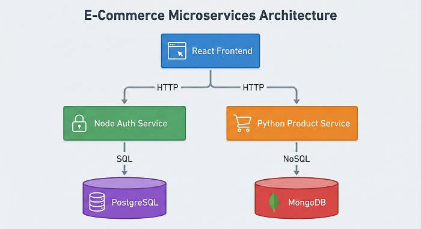

# 🛍️ Polyglot E-Commerce Microservices Cluster

### A Distributed System using Node.js, Python, React, and Docker

**The Goal:** Simulate a real-world enterprise architecture where different teams use different languages for specialized tasks, all orchestrated via Docker Compose.

**The Architecture:**
The system is composed of 3 distinct microservices and 2 databases:

1.  **Auth Service (Node.js + PostgreSQL):**
    * Handles User Registration & Login.
    * Issues **JWT (JSON Web Tokens)** for stateless authentication.
    * Why Node? High concurrency performance for I/O heavy auth tasks.
2.  **Product Service (Python Flask + MongoDB):**
    * Manages the dynamic Product Catalog.
    * Why Python/Mongo? Flexible schema for handling diverse product attributes.
3.  **Frontend (React.js):**
    * A modern dashboard that consumes both APIs.
    * Stores JWT in memory to authenticate requests.

---

## 🏗️ Infrastructure Diagram



---

## 🛠️ Tech Stack

* **Frontend:** React, Axios, CSS3
* **Backend A:** Node.js, Express, bcryptjs (Security)
* **Backend B:** Python 3.9, Flask, PyMongo
* **Databases:** PostgreSQL (Relational), MongoDB (Document)
* **DevOps:** Docker, Docker Compose (Multi-container orchestration)

---

## 🚀 How to Run Locally

1.  **Clone the Repo:**
    ```bash
    git clone https://github.com/TouseefQ/ecommerce-cluster.git
    cd ecommerce-cluster
    ```

2.  **Start the Cluster:**
    ```bash
    docker-compose up --build
    ```
    *This spins up 5 containers: Frontend, Auth, Product, Postgres, and Mongo.*

3.  **Access the App:**
    Open `http://localhost:3000` in your browser.

4.  **Test Data (Optional):**
    Run the included Python script to verify APIs and seed data:
    ```bash
    python verify_cluster.py
    ```

---

## 🧪 API Endpoints

| Service | Method | Endpoint | Description |
| :--- | :--- | :--- | :--- |
| **Auth** | POST | `/register` | Create a new user |
| **Auth** | POST | `/login` | Get JWT Token |
| **Product** | GET | `/products` | List all products |
| **Product** | POST | `/products` | Add a new product |